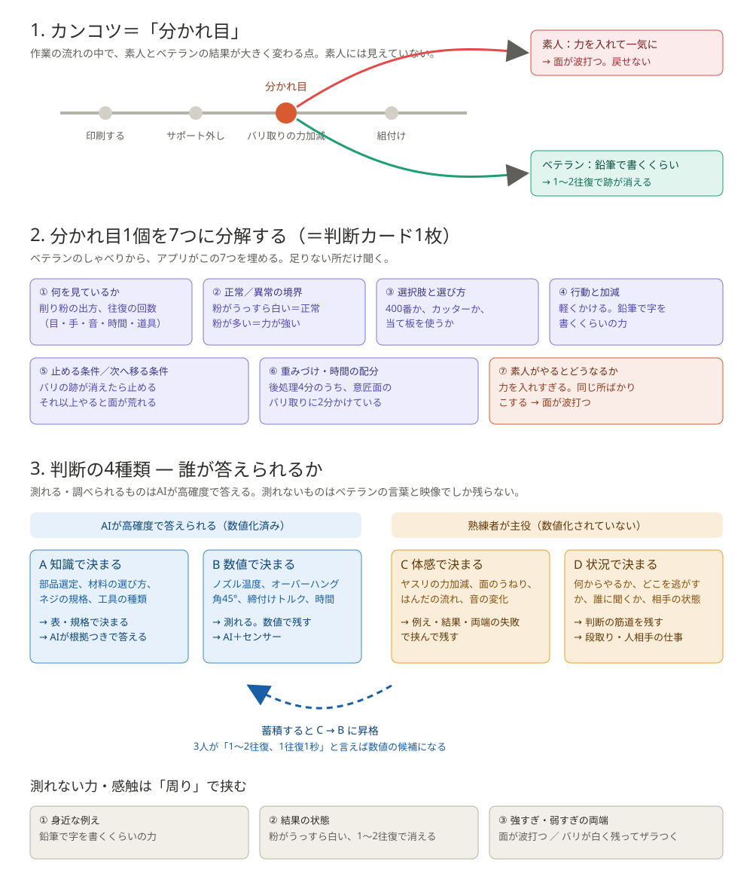

# 判断モデル（このアプリの芯）

> 作者の思いつき（2026-11-04）を分解して組み直したもの。このアプリの判断基準は「正解の手順」ではなく、**素人とベテランの分かれ目を見つけ、そこでの判断を分解して残す**ことに置く。

## 1. カンコツとは「分かれ目」
- 暗黙知は「技」そのものより、**「ここが分かれ目だ」と気づけること**と、**その分かれ目でどちらを選ぶか**の2つ。
- 素人は「何がわからないかわからない」＝分かれ目が見えていない。ベテランは分かれ目が見えていて、先に見えている。

## 2. 分かれ目1個の分解（判断の構造）
| 構成要素 | 中身 |
|---|---|
| ① 何を見ているか（手がかり） | 目・手・音・時間・道具の状態・素材の状態・もらった物の状態（図面・材料） |
| ② 正常／異常の境界 | どの状態が正常で、どこからが異常か |
| ③ 選択肢と選び方 | 何からやるか、誰に聞くか、どの道具を使うか。素人には選択肢自体が見えていない |
| ④ 行動と加減 | 力・速度・量・時間・姿勢 |
| ⑤ 止める条件／次へ移る条件 | どの状態で作業を止め、どの状態で次に移るか |
| ⑥ 重みづけ・配分 | どこに時間と注意を配るか |
| ⑦ 素人がやるとどうなるか | 一般人の作り方と、その結果（対比） |

聞き取りの質問はこの①〜⑦から生成する（分野プロファイルの質問テンプレ）。

## 3. 経験の差＝見てきた「状態の数」
- ベテランは正常・異常・失敗をたくさん見ているから、②の境界を細かく引ける。
- アプリでは、案件・失敗事例・異常状態の写真と言葉を溜め、新人が**先に見ておく**ことで、見てきた状態の数を疑似的に増やす。

## 4. 判断の4種類と数値化
| 種類 | 例 | 数値化 | 誰が答えられるか |
|---|---|---|---|
| A. 知識で決まる | 部品選定、材料の選び方、ネジの規格 | 済み（表・規格） | AIが高確度で答えられる |
| B. 数値で決まる | 締付けトルク、切削条件、3DPのオーバーハング角、音程 | 済み／できる | AI＋センサー。カラオケ採点が成立する理由 |
| C. 体感で決まる | ヤスリの食い込み、面のうねり、はんだの流れ、音の変化 | 未（物理には従うが人が測っていない） | ベテランの言葉と映像でしか残らない。本当の暗黙知 |
| D. 状況で決まる | 何からやるか、どこを逃がすか、誰に聞くか、相手（人）の状態 | 無理に近い | ベテランの判断の筋道を残す |

- **AIが確度の高い情報だけ出す＝A・Bの領域。熟練者が主役＝C・Dの領域。**「知識の出どころ」のルールの根拠。
- 数値化が進んでいる分野：溶接（電流・電圧・速度・入熱）、切削（送り・回転数・切込み）、射出成形（温度・圧力・冷却）、**3Dプリント（温度・層高・壁厚・オーバーハング角45°目安・サポート角）**、塗装（膜厚・吐出量・ガン距離）、締付け（トルク）、調理（温度・時間）、歌（音程・リズム）。
- 数値化されていない：面の読み、感触、音の変化、タイミング、段取りの優先順位、どこを逃がすか、人が相手の仕事。
- 3DPはBとCが混ざった題材。「オーバーハング45°」はB、「ツメが薄いから15°傾ける」はB寄りのC、「サポート外しで意匠面に傷が入るから当て板」はC。

## 4b. 蓄積とともに言語化・数値化する
- 数値化されていないジャンル（C・D）も、データの蓄積とともに徐々に言語化・数値化できるアプリにする。
- 同じ分かれ目のカードが溜まるほど、「軽く」「少し傾ける」といった体感の言葉に数値（例：15°〜30°）や写真が紐づく。
- アプリは「数値化できそうな候補」（同じ手順で複数のカードが似た数値・条件を語っている所）を示し、ベテランが確認すれば C→B に昇格する。
- MVPでは候補の表示まで。将来はセンサー値（温度・トルク・時間）との突き合わせも。

## 4c. AIは力・感触を測れない（Cの残し方）
力そのものではなく、力の「周り」にある測れるもので挟む。
| 方法 | 内容 | 例（ヤスリで意匠面のバリを取る） |
|---|---|---|
| ① 身近な例えで残す | 「身近なもので言うと？」と聞く | 鉛筆で字を書くくらいの力 |
| ② 結果の状態で残す | 力が正しいと何がどうなるか | 削り粉がうっすら白く出る、音がシャッと軽い、1往復で跡が消える |
| ③ 強すぎ・弱すぎの両端で挟む | 失敗の写真を両側に置く | 強すぎ：面が波打つ／弱すぎ：バリが残る |
| ④ 映像から取れる数で代用 | 回数・速さ・時間は動画から取れる | 往復3回、1回1秒、手順に40秒 |
| ⑤ 新人が自分で撮って比べる | 新人の動画とベテランの動画を並べ、速さ・音・結果を比べる | 往復が速すぎて力が入りすぎ |
| ⑥（将来）センサー | トルク・力覚・温度の値を紐づける | 締付けトルク、こて先温度 |

- 新人は「力の数値」ではなく「正しい力のときに見える結果」で自分を確認する。
- AIの役割：①②③を引き出す質問を出す／④を動画から自動で出す／AI自身は力を推測しない。推測するなら「未確認」ラベルで熟練者の言葉より下に置く。
- 判断カードの「加減」欄は、①例え ②結果の状態 ③両端の失敗 の3点で書く。

## 5. 「手順の追求を諦めた」への答え
- 言語化のリソース：ベテランは撮ってしゃべるだけ。①〜⑦への分解はアプリがやる。
- 一気に覚えられない：分かれ目1個＝カード1枚に分け、教育モードで1個ずつ止めて問う。「やっている途中に止められる」＝分かれ目を体で知る。
- 将来：作業中の新人をカメラでリアルタイムに止める。MVPでは「動画が分かれ目で止まる」で代用。

## 6. 機能への落とし込み
1. **分かれ目マーカー**：カードごとに「分かれ目」の印と⑦の対比。手順書の中で分かれ目だけ光る。
2. **止める条件・次へ移る条件**：カードに⑤を持つ。教育モードで「いま止める？まだ？」と問える。
3. **判断の種類タグ（A〜D）**：A・BはAIが数値・根拠を添える。C・Dは熟練者の言葉が主役。AIの確度はこれで決まる。
4. **配分ビュー**：文字起こしの時刻から各手順の時間の割合を自動で出す（⑥）。追加コストほぼゼロ。
5. **異常状態ライブラリ**：失敗・異常の写真と言葉を溜める。新人は作業前に「異常を見る」。
6. **聞き取りの質問は①〜⑦から生成**：「ここで何を見てた？」「どうなったら止める？」「素人がやるとどうなる？」。
